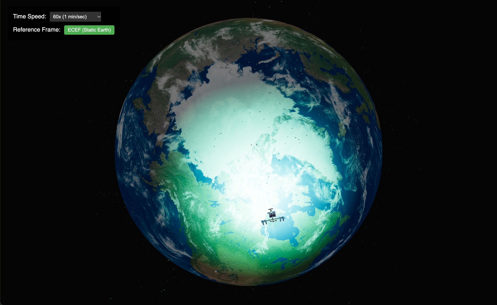

# Vanguard SSA

Vanguard SSA is a browser-based space situational awareness prototype for visualizing Earth, satellite orbits, and tracked debris.

## Description

Vanguard SSA combines a React, Three.js interface with a Rust orbital-data service. The interface renders Earth, satellite, and debris models in a 3D scene, streams trajectory updates over WebSockets, and lets you change the simulation time multiplier and reference frame (ECEF or ECI). The Rust service loads Two-Line Element (TLE) data from CelesTrak, uses SGP4 to estimate positions, and caches the source data locally. The primary telemetry input is currently simulated, so the display and collision warnings are for demonstration only and are not suitable for operational tracking or collision-avoidance decisions.

### Screenshots



## Getting Started

### Dependencies

- Rust stable with Cargo (the project uses Rust edition 2024).
- Node.js 22 and npm for the React/Vite frontend.
- Docker is optional for running the complete app as one container.
- A recent Linux or macOS environment. The first backend launch needs internet access to fetch TLE data from CelesTrak unless usable cache files are present.

### Installing

- Clone the repository and enter its root directory:

```sh
git clone https://github.com/abdulgafarabdurrasheed/Vanguard-SSA.git
cd Vanguard-SSA
```

- Install the frontend dependencies:

```sh
cd vanguard-ui
npm ci
cd ..
```

- No extra files need to be created for a local development run. The checked-in TLE cache files are used as a fallback when CelesTrak cannot be reached.

### Executing program

- Start the Rust backend from the repository root:

```sh
cargo run
```

- Open a second terminal in the repository root, then start the Vite frontend and point its WebSocket connection at the backend:

```sh
cd vanguard-ui
VITE_BACKEND_URL=http://localhost:3000 npm run dev
```

- Open the local URL printed by Vite (usually `http://localhost:5173`). The Rust server's health endpoint is available at `http://localhost:3000/health`.
- To build and run the full app in Docker instead:

```sh
docker build -t vanguard-ssa .
docker run --rm -p 3000:3000 -e PORT=3000 vanguard-ssa
```

- Open `http://localhost:3000` when the container is running.

## Help

- If the page loads but does not update, confirm the Rust backend is running and that `VITE_BACKEND_URL` points to it. For a non-default backend port, set `PORT` when starting the Rust server and use the same port in `VITE_BACKEND_URL`.
- If satellite or debris data is missing, check the backend logs for CelesTrak access errors and confirm the cached `active_satellites.txt` and `debris.txt` files are available.
- Check backend health at `http://localhost:3000/health`.

## License

No license has been specified yet, and this repository does not currently include a `LICENSE.md` file.
